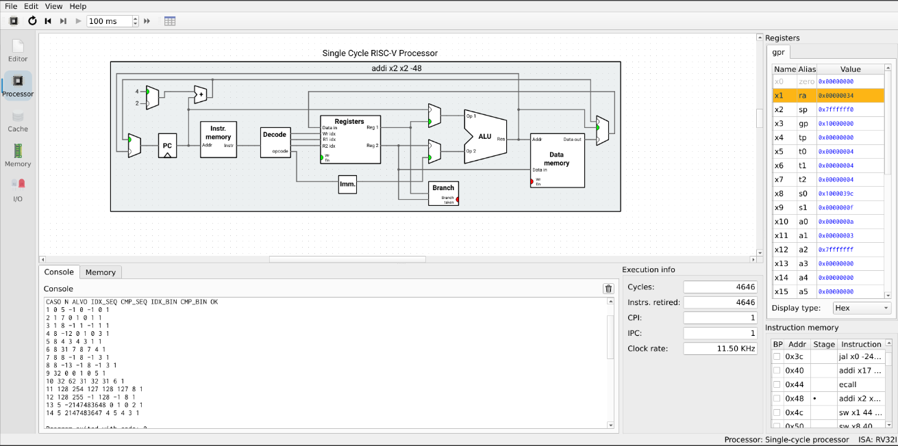
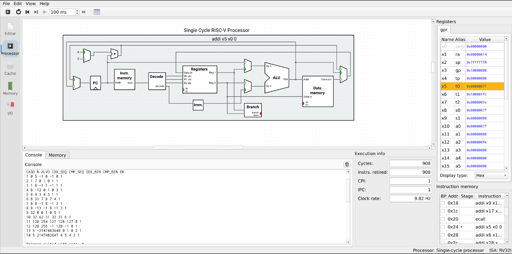
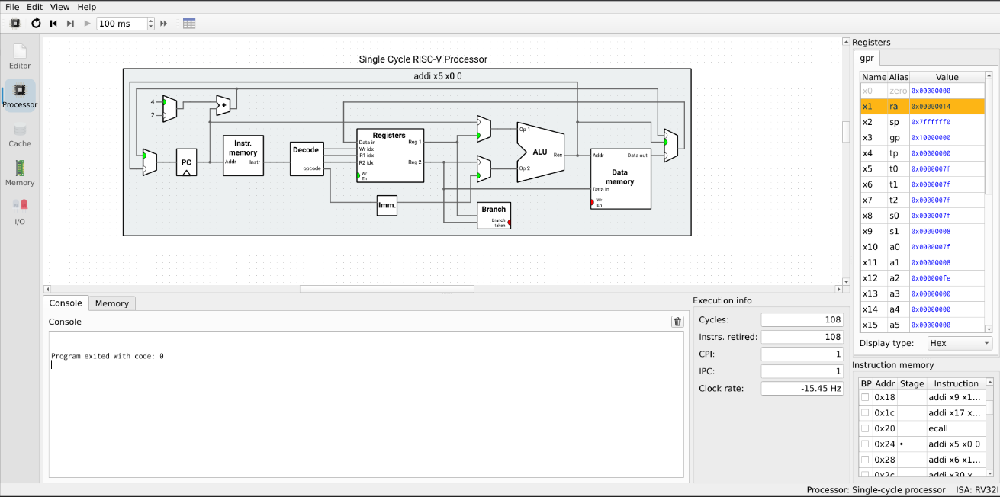

# Busca binária e sequencial em Assembly RISC-V (RV32I)

**Universidade Católica de Santos — UniSantos**  
**Curso:** Ciências da Computação  
**Disciplina:** Arquitetura de Computadores  
**Professor:** Walter S. Oliveira  
**Estudante:** Vitor Amorim Tartari  
**Tema:** 4 — Busca em vetores ordenados

## 1. Objetivo

Comparar o funcionamento e o desempenho dos algoritmos de busca sequencial e busca binária em vetores ordenados, utilizando Assembly RISC-V (RV32I) e o simulador Ripes.

O programa recebe vetores de números inteiros, seus respectivos tamanhos e os valores procurados. Como resultado, retorna o índice encontrado ou -1 quando o elemento não existe, além da quantidade de elementos examinados.

## 2. Algoritmos

### Busca sequencial

Percorre o vetor desde a primeira posição, verificando cada elemento até encontrar o valor procurado ou chegar ao final.

### Busca binária

Verifica o elemento central do vetor e elimina metade do intervalo de busca a cada iteração. Para funcionar corretamente, o vetor precisa estar ordenado.

| Algoritmo | Melhor caso | Pior caso |
|---|---|---|
| Busca sequencial | O(1) | O(N) |
| Busca binária | O(1) | O(log N) |

## 3. Implementação

O código principal está disponível em [src/main.s](src/main.s).

A implementação utiliza instruções da arquitetura RV32I, sem necessidade das extensões M e C.

As buscas foram organizadas em sub-rotinas independentes, utilizando jal para chamadas e jalr para retornos.

### Registradores

| Registrador | Função |
|---|---|
| a0 | Endereço do vetor e retorno do índice |
| a1 | Tamanho do vetor e quantidade de elementos examinados |
| a2 | Valor procurado |
| t0–t5 | Variáveis temporárias |
| s0–s9 | Preservação de dados |
| ra | Endereço de retorno |
| sp | Ponteiro da pilha |

A rotina executar_caso utiliza 48 bytes da pilha para preservar o contexto durante as chamadas.

### Organização da memória

A seção .data armazena os vetores e os casos de teste. A seção .text contém as instruções executáveis.

Cada elemento do vetor ocupa quatro bytes. O cálculo dos endereços é realizado por deslocamentos de bits e operações de soma.

## 4. Como executar

1. Acesse https://ripes.dk/.
2. Selecione o processador Single Cycle de 32 bits.
3. Desabilite as extensões M e C.
4. Carregue o arquivo src/main.s como Source file.
5. Execute o programa.
6. Verifique os resultados no console.

Não é necessária a configuração de periféricos adicionais.

Exemplo de saída para a busca pelo número 254:

```text
CASO N ALVO IDX_SEQ CMP_SEQ IDX_BIN CMP_BIN OK
11 128 254 127 128 127 8 1
```

O valor 1 na coluna OK indica que o resultado corresponde ao esperado.

## 5. Testes funcionais

Foram executados 14 casos de teste, incluindo vetores vazios, números negativos, elementos presentes e ausentes e vetores de diferentes tamanhos.

Todos os 14 casos foram aprovados no Ripes em 24/11/2026.

| Métrica | Resultado |
|---|---:|
| Testes aprovados | 14/14 |
| Ciclos | 4646 |
| Instruções executadas | 4646 |
| CPI | 1,00 |
| Código de saída | 0 |



## 6. Comparação de desempenho

Para comparar os algoritmos no Ripes, foi utilizado um vetor ordenado com 128 elementos, procurando o valor 254, localizado na última posição.

| Métrica | Sequencial | Binária |
|---|---:|---:|
| Índice encontrado | 127 | 127 |
| Elementos examinados | 128 | 8 |
| Instruções executadas | 908 | 108 |
| Ciclos | 908 | 108 |
| CPI | 1,00 | 1,00 |

A busca binária apresentou uma redução de 93,75% na quantidade de elementos examinados e de 88,11% no total de ciclos.

### Busca sequencial



### Busca binária



### Testes complementares

Os resultados abaixo foram obtidos com um interpretador funcional RV32I em Python, utilizado como ferramenta auxiliar de validação.

| Cenário | Elementos examinados - Sequencial | Elementos examinados - Binária |
|---|---:|---:|
| 8 elementos, início | 1 | 3 |
| 8 elementos, fim | 8 | 4 |
| 32 elementos, fim | 32 | 6 |
| 128 elementos, fim | 128 | 8 |
| 128 elementos, alvo acima do máximo | 128 | 8 |

O interpretador funcional não simula ciclos de CPU. As medições arquiteturais apresentadas anteriormente foram coletadas diretamente no Ripes. Os outros oito benchmarks ainda não foram medidos nesse simulador.

## 7. Conclusão

Os resultados demonstram que a busca binária é mais eficiente para localizar elementos distantes do início de vetores ordenados de maior tamanho.

A busca sequencial possui uma implementação mais simples e pode apresentar vantagens quando o elemento procurado está próximo da primeira posição.

O projeto permite compreender o uso de registradores, memória, pilha, sub-rotinas e instruções condicionais na arquitetura RISC-V, além da influência da escolha do algoritmo no desempenho do programa.

## 8. Recursos utilizados

- Assembly RISC-V RV32I.
- Ripes Online.
- GitHub.
- Python e Clang/LLD para validação complementar.

## 9. Referências

- Material da disciplina de Arquitetura de Computadores — UniSantos.
- Ripes: https://github.com/mortbopet/Ripes
- RISC-V International: https://riscv.org/technical/specifications/
